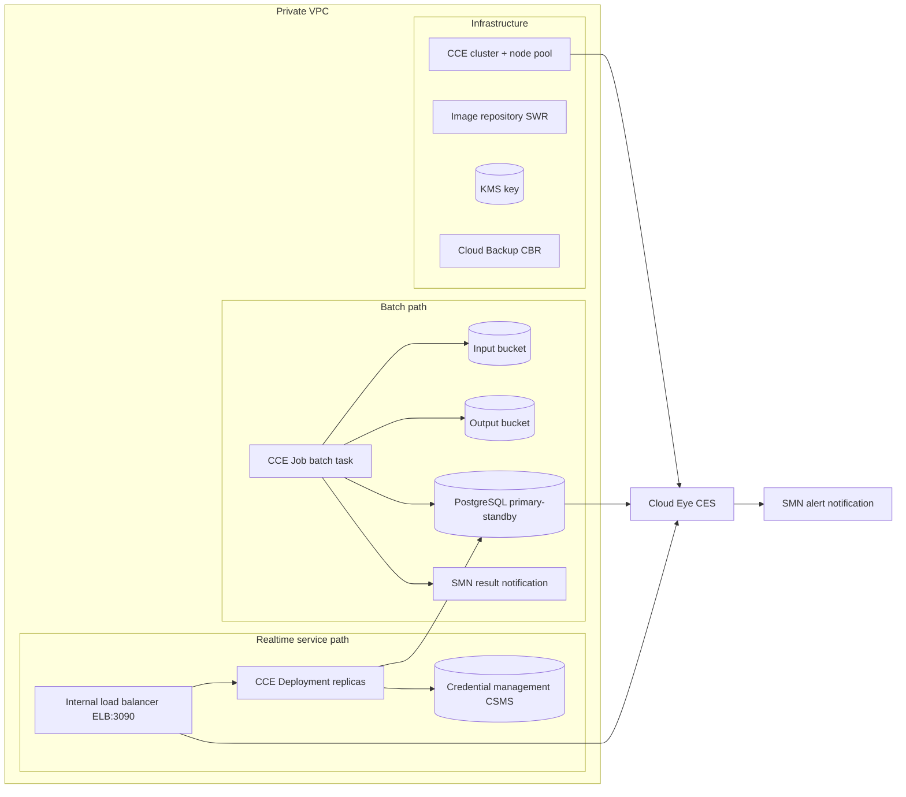

# enterprise-mainframe-container-orchestration

[](LICENSE)
[](https://support.huaweicloud.com/intl/en-us/)
[](#)
> A container orchestration environment for Java workloads produced by mainframe application modernization.

## 1. Overview

This practice provides a modular Terraform infrastructure for building a **container orchestration environment** that hosts Java workloads produced by mainframe application modernization. The environment runs containerized workloads in two forms — batch (one-off jobs) and realtime (long-running services) — and is equipped with private networking, object storage, relational database, key management, image registry, monitoring and alerting. It targets DevOps / infrastructure engineers and can serve as a reference architecture and production template for mainframe modernization on cloud.

### Core capabilities

- **Modular IaC**: 8 independent, reusable modules — network / storage / key / database / permission / batch / realtime / monitoring
- **Two workload forms**: batch jobs (run once and exit) + realtime services (replicated, behind an internal load balancer)
- **Private-first**: deployed on the internal network by default, business workloads not directly exposed to the public internet
- **Complete supporting stack**: input/output object storage, PostgreSQL primary-standby, credential management, scheduled backup, full monitoring and alerting coverage

---

## 2. Table of Contents

- [1. Overview](#1-overview)
- [2. Table of Contents](#2-table-of-contents)
- [3. Architecture Diagram](#3-architecture-diagram)
- [4. Highlights](#4-highlights)
- [5. Cloud Services Used](#5-cloud-services-used)
- [6. Prerequisites](#6-prerequisites)
- [7. Quick Start](#7-quick-start)
- [8. Step-by-Step Deployment](#8-step-by-step-deployment)
- [9. Usage / Verification](#9-usage--verification)
- [10. Cleanup](#10-cleanup)
- [11. Detailed Explanation](#11-detailed-explanation)
- [12. Dependencies](#12-dependencies)
- [13. FAQ / Troubleshooting](#13-faq--troubleshooting)
- [14. Contributing](#14-contributing)
- [15. License](#15-license)
- [16. Contact / Maintainers](#16-contact--maintainers)

---

## 3. Architecture Diagram

> Within one private VPC, the container platform hosts both "batch tasks" and "realtime services", supported by storage, database, keys, and monitoring.



**Key component description**:
- **CCE (Cloud Container Engine)**: managed Kubernetes cluster hosting batch Jobs and realtime Deployments
- **ELB (Elastic Load Balance)**: internal network-type load balancer exposing the realtime service over TCP port 3090 inside the VPC
- **RDS (Relational Database Service)**: PostgreSQL primary-standby instance for business data
- **OBS (Object Storage Service)**: input / output buckets for batch processing
- **SMN (Simple Message Notification)**: notification channel for batch results and monitoring alerts

---

## 4. Highlights

- **Modular and reusable**: 8 functional modules separated by responsibility, ready to reuse or trim
- **Batch + realtime in one environment**: one-off batch tasks and long-running realtime services coexist in one orchestration environment
- **Private by default**: workloads do not expose public endpoints by default; the database is only accessible within the same VPC
- **Full observability**: database / load balancer / cluster metrics feed into Cloud Eye, and alerts are delivered via SMN

---

## 5. Cloud Services Used

| Service | Purpose | Notes |
|---|---|---|
| VPC (Virtual Private Cloud) | Private network / subnets / security groups | Workloads deployed on the internal network by default |
| CCE (Cloud Container Engine) | Container orchestration cluster + node pool | Hosts batch and realtime workloads |
| SWR (Software Repository for Containers) | Business image storage and distribution | Private repository |
| ELB (Elastic Load Balance) | Internal access to the realtime service | Network type, TCP 3090 |
| RDS (Relational Database Service) | PostgreSQL primary-standby | Business data |
| OBS (Object Storage Service) | Batch input / output buckets | Versioned + encrypted |
| DEW (Data Encryption Workshop) | KMS keys + CSMS secrets | Storage / database encryption and credentials |
| CBR (Cloud Backup and Recovery) | Scheduled database backup | Daily backup + retention policy |
| SMN (Simple Message Notification) | Batch result / monitoring alert notifications | Email, SMS, etc. can be subscribed |
| CES (Cloud Eye Service) | Metric alarms | Database / load balancer / cluster |
| LTS (Log Tank Service) | Container log aggregation | 30-day retention |

> **Tip**: All services can be created with one command via this repository's Terraform; for cleanup, see [Section 10 "Cleanup"](#10-cleanup).

---

## 6. Prerequisites

| Item | Requirement | Notes |
|---|---|---|
| **Account** | Huawei Cloud account opened and real-name authenticated | Personal or enterprise accounts are both acceptable |
| **Permissions** | IAM **Tenant Administrator** or equivalent permissions | For creating VPC / CCE / RDS / OBS and other resources |
| **Region** | `cn-north-4` recommended | Cross-region service availability may differ |
| **Terraform** | `>= 1.3.0` | IaC deployment tool |
| **huaweicloud Provider** | `~> 1.94` | Huawei Cloud Terraform Provider |
| **kubernetes Provider** | `~> 2.30` | Kubernetes workload management |
| **kubectl** *(optional)* | `>= 1.28` | K8s cluster management (as needed) |
| **AK/SK** | Obtain Access Key ID and Secret Access Key from the Huawei Cloud "My Credentials" page and fill them into the deployment script | **Do not** write credentials into any code or configuration files |

---

## 7. Quick Start

### One-click deployment (recommended)

```bash
# 1. Clone this repository
git clone https://github.com/huaweicloud-samples/enterprise-mainframe-container-orchestration.git enterprise-mainframe-container-orchestration
cd enterprise-mainframe-container-orchestration

# 2. Prepare Huawei Cloud AK/SK (see Prerequisites §6)
export HW_ACCESS_KEY="<your-access-key>"
export HW_SECRET_KEY="<your-secret-key>"

# 3. Prepare the variable file
cd infra
cp terraform.tfvars.example terraform.tfvars
# Edit terraform.tfvars: set the database password, CCE node authentication method, etc.

# 4. One-click deployment
terraform init
terraform plan
terraform apply -auto-approve
```

> **Deployment time**: about 10-20 minutes (depending on the number of resources).
> **Complete steps and expected output for each step**: see [Section 8 "Step-by-Step Deployment"](#8-step-by-step-deployment).

---

## 8. Step-by-Step Deployment

### Step 1: Initialize the working directory

```bash
cd infra
terraform init
```

**Expected output**: `Terraform has been successfully initialized!`

### Step 2: Configure variables

```bash
cp terraform.tfvars.example terraform.tfvars
vi terraform.tfvars
```

**Expected output**: the variable file is ready. At minimum set `db_password`; choose either `cce_node_password` or `cce_node_key_pair` for CCE node authentication.

### Step 3: Preview resource changes

```bash
terraform plan
```

**Expected output**: `Plan: 47 to add, 0 to change, 0 to destroy.` (resource count varies with the batch configuration)

### Step 4: Execute deployment

```bash
terraform apply -auto-approve
```

**Expected output**: `Apply complete! Resources: 47 added, 0 changed, 0 destroyed.`

### Step 5: Record key outputs

```bash
terraform output
```

**Expected output**: lists the CCE cluster ID, SWR repository address, input/output buckets, database private endpoint, internal load balancer address, SMN topic URN, etc. Save them for subsequent verification.

---

## 9. Usage / Verification

> **Verified before delivery**: The commands / examples listed in this section have been executed and verified before delivery; they run and their output matches the description. After deployment, follow these steps to verify that the business functionality works before considering the delivery complete.

### Verification 1: Container cluster and namespace ready

```bash
terraform output cce_cluster_id
kubectl get ns <stack_prefix>   # default: mainframe-orchestration
```

**Expected output**: non-empty cluster ID; namespace in `Active` state.

### Verification 2: Database is reachable

```bash
# Get the database private endpoint and admin password (db_password in terraform.tfvars)
psql -h $(terraform output -raw db_private_endpoint) -U root -d postgres -p 5432
```

**Expected output**: can connect to PostgreSQL, and `SELECT 1;` returns `1`.

### Verification 3: Batch job executes successfully

```bash
kubectl -n mainframe-orchestration get jobs
kubectl -n mainframe-orchestration logs job/mainframe-orchestration-module1
```

**Expected output**: Job in `Complete` state; the log shows the batch wrapper finished.

### Verification 4: Realtime service is accessible (inside the VPC)

```bash
# Access the internal load balancer address from a host inside the same VPC
curl telnet://$(terraform output -raw realtime_elb_address):3090
```

**Expected result**: TCP connection succeeds; the realtime interface responds according to the business protocol.

### Verification 5: Monitoring alert channel is usable

```bash
terraform output alert_smn_topic
```

**Expected output**: returns the SMN topic URN; add subscriptions (email / SMS) to the topic in the SMN console, then trigger a high database load to receive an alert.

---

## 10. Cleanup

```bash
# Enter the deployment directory
cd infra

# Release all resources with one command
terraform destroy -auto-approve
```

**Expected output**: `Destroy complete! Resources: 47 destroyed.`

> **Avoid leftover resources**:
> - `terraform destroy` releases only resources tracked in the Terraform state;
> - Resources created directly via API / console (such as manually pushed SWR images or manually created EIPs / SMN subscriptions) must be released manually;
> - Shared resources (VPCs / agencies used by other tasks in the account) are not affected.

---

## 11. Detailed Explanation

### Workflow

- **Batch path**: an external trigger starts a one-off Job → CCE pulls the business image from SWR → reads input bucket data, processes it, and writes results to the output bucket → sends a result notification to the SMN topic.
- **Realtime path**: a client inside the VPC accesses the internal load balancer ELB (TCP 3090) → the request is forwarded to CCE Deployment replicas (registered as backends) → the replicas read business data from the database and respond.
- **Maintenance path**: database CPU / memory / connections / storage / replication delay, load balancer healthy host count, and cluster node status feed into CES; alerts are sent to the SMN topic.

### Configuration items

| Variable | Default | Description |
|---|---|---|
| `region` | `cn-north-4` | Deployment region |
| `stack_prefix` | `mainframe-orchestration` | Resource naming prefix |
| `vpc_cidr` | `172.16.0.0/23` | VPC CIDR |
| `azs` | `cn-north-4a`,`cn-north-4b` | Availability zones |
| `db_flavor` | `rds.pg.n1.large.2.ha` | Database instance flavor |
| `container_image` | SWR business image address | Business container image (replace after push) |
| `cce_node_flavor` | `s6.large.2` | Node flavor |
| `cce_node_count` | `2` | Node count |
| `realtime_replicas` | `2` | Realtime service replicas |
| `batch_tasks` | module1 / module2 | Batch task list |
| `direct_internet_access_required` | `false` | Whether the batch job needs public internet egress |

### Interfaces / APIs

| Entry | Address | Description |
|---|---|---|
| Realtime service | `<realtime_elb_address>:3090` (inside the VPC) | Internal load balancer address |
| Database | `<db_private_endpoint>:5432` (inside the VPC) | PostgreSQL primary-standby |

---

## 12. Dependencies

### Main dependencies

| Name | Version | Purpose |
|---|---|---|
| Terraform | `>= 1.3.0` | IaC orchestration |
| huaweicloud Provider | `~> 1.94` | Huawei Cloud resources |
| kubernetes Provider | `~> 2.30` | Kubernetes workloads |
| random Provider | `~> 3.6` | Random password generation |

---

## 13. FAQ / Troubleshooting

### Q1: What if deployment reports "insufficient permissions"?

**A**: Confirm the account has IAM **Tenant Administrator** permissions, or at least sub-service administrator permissions such as `VPC Administrator`, `CCE Administrator`, `RDS Administrator`, and `OBS Administrator`.

### Q2: CCE nodes remain Pending after cluster creation?

**A**: Nodes usually cannot be scheduled when the private subnet has no outbound internet access, causing CCE to add the `route-unreachable` taint. Configure a NAT gateway + SNAT for the node pool subnet (set `direct_internet_access_required` to `true`), or configure a key pair for the nodes in the node pool so they can initialize properly.

### Q3: SWR image pull returns 401?

**A**: SWR repositories are private by default. Push the image in advance and make sure the cluster nodes have pull permission. See `terraform output swr_repository`; you can generate login instructions in the console to complete `docker push`.

### Troubleshooting checklist

| Symptom | Possible cause | Troubleshooting method |
|---|---|---|
| `terraform plan` reports a missing variable | `terraform.tfvars` not created or fields not filled | `cp terraform.tfvars.example terraform.tfvars` and fill it in |
| Batch Job status `Failed` | Image not pushed / input bucket empty | `kubectl logs job/<name>` to view container logs |
| Realtime service timeout via ELB | Security group does not allow 3090 / replicas not ready | Check `kubectl get pods` and the security group rules |
| Database connection refused | Security group does not allow the VPC CIDR | Confirm the `db` security group ingress contains `vpc_cidr` |

---

## 14. Contributing

Issues and PRs are welcome. Please follow this process:

1. **Issue**: describe the problem / suggestion (include reproduction commands, expected / actual output, screenshots)
2. **PR**: create a feature branch from `main`; run `terraform validate` and `terraform fmt -check` before committing

See `CONTRIBUTING.md` for details (if any).

---

## 15. License

This practice is released under the **MIT No Attribution** license. See [`LICENSE`](LICENSE) in the repository root.

```
MIT No Attribution

Copyright (c) Huawei Cloud

Permission is hereby granted, free of charge, to any person obtaining a copy
of this software... (no attribution required)
```

---

## 16. Contact / Maintainers
| Item | Content |
|---|---|
| **Creator** | [dgc-git](https://github.com/dgc-git) |
| **Maintainer** | [dgc-git](https://github.com/dgc-git) |
| **Contact** | GitHub Issues / PR (see [Section 14](#14-contributing)) |
