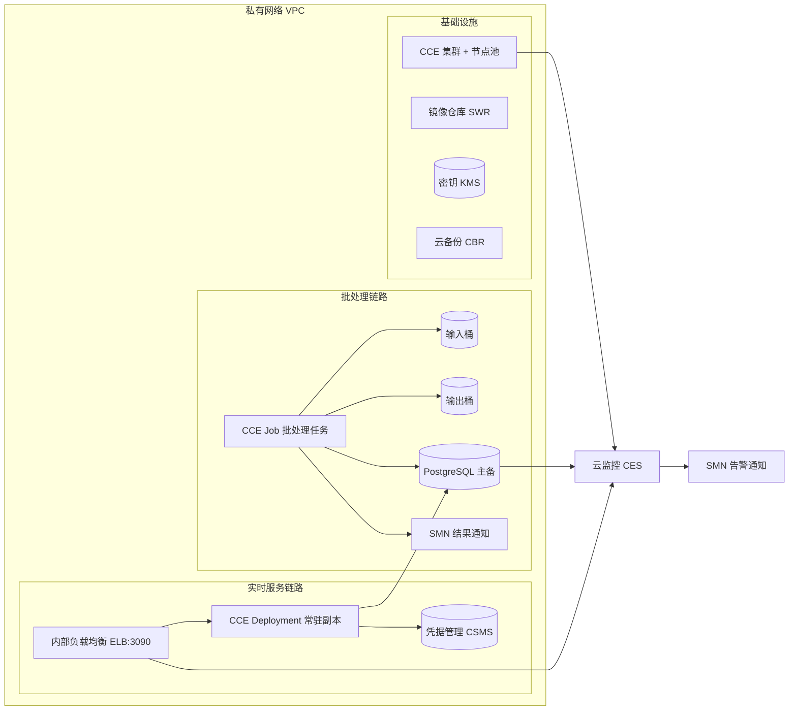

# enterprise-mainframe-container-orchestration / 大型机现代化应用容器化编排环境

[](LICENSE)
[](https://support.huaweicloud.com/intl/en-us/)
[](#)
> 为大型机（mainframe）应用现代化后的 Java 负载提供容器化编排环境
---

## 1. 简介 / Overview

本实践提供一套模块化的 Terraform 基础设施，用于搭建承载大型机应用现代化后 Java 负载的**容器化编排环境**。环境以批处理（一次性任务）与实时（常驻服务）两种形态运行容器化业务，并配齐私有网络、对象存储、关系数据库、密钥管理、镜像仓库、监控告警等周边能力。面向 DevOps / 基础设施工程师，可作为大型机现代化上云场景的参考架构与生产模板。

### 核心能力

- **模块化 IaC**：网络 / 存储 / 密钥 / 数据库 / 权限 / 批处理 / 实时服务 / 监控 8 个模块独立可复用
- **两种负载形态**：批处理任务（一次性运行、结束即退出）+ 实时服务（常驻副本、内部负载均衡接入）
- **私网优先**：默认内网部署，业务工作负载不直接暴露公网
- **完整配套**：对象存储输入输出、PostgreSQL 主备、凭据管理、定时备份、监控告警全覆盖

---

---

## 2. 目录

- [1. 简介 / Overview](#1-简介--overview)
- [2. 目录](#2-目录)
- [3. 架构图](#3-架构图)
- [4. 方案亮点](#4-方案亮点)
- [5. 涉及云服务](#5-涉及云服务)
- [6. 前置条件](#6-前置条件)
- [7. 快速开始](#7-快速开始)
- [8. 分步部署](#8-分步部署)
- [9. 使用方法 / 验证](#9-使用方法--验证)
- [10. 清理资源](#10-清理资源)
- [11. 详细说明](#11-详细说明)
- [12. 依赖](#12-依赖)
- [13. FAQ / 故障排除](#13-faq--故障排除)
- [14. 贡献指南](#14-贡献指南)
- [15. 许可证](#15-许可证)
- [16. 联系方式 / 维护者](#16-联系方式--维护者)

---

---

## 3. 架构图

> 一个私有网络内，容器平台同时承载「批处理任务」与「实时服务」两种形态，配套存储、数据库、密钥与监控。



**关键组件说明**：
- **CCE（云容器引擎）**：托管 Kubernetes 集群，承载批处理 Job 与实时 Deployment
- **ELB（弹性负载均衡）**：内部网络型负载均衡，将实时服务以 TCP 3090 端口对外（VPC 内网）暴露
- **RDS（关系型数据库服务）**：PostgreSQL 主备实例，业务数据存储
- **OBS（对象存储服务）**：批处理输入桶 / 输出桶
- **SMN（消息通知服务）**：批处理结果通知与监控告警通道

---

---

## 4. 方案亮点

- **模块化可复用**：8 个功能模块按职责拆分，可直接引用或按需裁剪
- **批/实一体**：一次性批处理任务与常驻实时服务在同一套编排环境内并存
- **默认内网**：业务负载默认不暴露公网，数据库仅同 VPC 可访问
- **全链路可观测**：数据库 / 负载均衡 / 集群指标统一接入云监控，告警经消息通知触达

---

---

## 5. 涉及云服务

| 服务 | 用途 | 备注 |
|---|---|---|
| VPC（虚拟私有云） | 私有网络 / 子网 / 安全组 | 业务默认内网部署 |
| CCE（云容器引擎） | 容器编排集群 + 节点池 | 承载批处理与实时负载 |
| SWR（容器镜像仓库） | 业务镜像存储与分发 | 私有仓库 |
| ELB（弹性负载均衡） | 实时服务内部接入 | 网络型，TCP 3090 |
| RDS（关系型数据库服务） | PostgreSQL 主备 | 业务数据 |
| OBS（对象存储服务） | 批处理输入 / 输出桶 | 版本化 + 加密 |
| DEW（数据加密服务） | KMS 密钥 + CSMS 凭据 | 存储 / 数据库加密与凭据 |
| CBR（云备份） | 数据库定时备份 | 每日备份 + 保留策略 |
| SMN（消息通知服务） | 批处理结果 / 监控告警通知 | 可订阅邮件、短信等 |
| CES（云监控服务） | 指标告警 | 数据库 / 负载均衡 / 集群 |
| LTS（云日志服务） | 容器日志汇聚 | 30 天保留 |

> **提示**：所有服务均可通过本仓库的 Terraform 一键创建；如需清理，请参见 [第 10 节「清理资源」](#10-清理资源)。

---

---

## 6. 前置条件

| 项 | 要求 | 说明 |
|---|---|---|
| **账号** | 已开通华为云账号并完成实名认证 | 个人/企业账号均可 |
| **权限** | 账号具备 IAM **Tenant Administrator** 或等效权限 | 用于创建 VPC / CCE / RDS / OBS 等资源 |
| **Region** | 推荐 `cn-north-4`（北京四） | 跨 region 可能涉及服务可用性差异 |
| **Terraform** | `>= 1.3.0` | IaC 部署工具 |
| **huaweicloud Provider** | `~> 1.94` | 华为云 Terraform Provider |
| **kubernetes Provider** | `~> 2.30` | Kubernetes 工作负载管理 |
| **kubectl** *(可选)* | `>= 1.28` | K8s 集群管理（按需） |
| **AK/SK** | 在华为云『我的凭证』页面获取 Access Key ID 与 Secret Access Key，并填入部署脚本 | **不要**将凭据写入任何代码或配置文件 |

---

---

## 7. 快速开始

### 一键部署（推荐）

```bash
# 1. 克隆本仓库
git clone https://github.com/huaweicloud-samples/enterprise-mainframe-container-orchestration.git enterprise-mainframe-container-orchestration
cd enterprise-mainframe-container-orchestration

# 2. 准备华为云 AK/SK（参见 [前置条件 §6](#6-前置条件)）
export HW_ACCESS_KEY="<your-access-key>"
export HW_SECRET_KEY="<your-secret-key>"

# 3. 准备变量文件
cd infra
cp terraform.tfvars.example terraform.tfvars
# 编辑 terraform.tfvars：填写数据库密码、CCE 节点认证方式等

# 4. 一键部署
terraform init
terraform plan
terraform apply -auto-approve
```

> **部署耗时**：约 10-20 分钟（视资源数量而定）。
> **完整步骤与每步预期输出**：参见 [第 8 节「分步部署」](#8-分步部署)。

---

---

## 8. 分步部署

### 步骤 1：初始化工作目录

```bash
cd infra
terraform init
```

**预期输出**：`Terraform has been successfully initialized!`

### 步骤 2：配置变量

```bash
cp terraform.tfvars.example terraform.tfvars
vi terraform.tfvars
```

**预期输出**：变量文件就绪。至少填写 `db_password`；CCE 节点认证在 `cce_node_password` 与 `cce_node_key_pair` 中二选一。

### 步骤 3：预演资源变更

```bash
terraform plan
```

**预期输出**：`Plan: 47 to add, 0 to change, 0 to destroy.`（资源数随批次配置变化）

### 步骤 4：执行部署

```bash
terraform apply -auto-approve
```

**预期输出**：`Apply complete! Resources: 47 added, 0 changed, 0 destroyed.`

### 步骤 5：记录关键输出

```bash
terraform output
```

**预期输出**：列出 CCE 集群 ID、SWR 仓库地址、输入/输出桶、数据库内网地址、内部负载均衡地址、SMN 主题 URN 等，请妥善保存用于后续验证。

---

---

## 9. 使用方法 / 验证

> **强制实测**：本节所列命令 / 示例已在交付前执行验证，可运行且输出与描述一致。部署完成后请按本节步骤自行验证，确认业务功能可用，方可视为交付完成。

### 验证 1：容器集群与命名空间就绪

```bash
terraform output cce_cluster_id
kubectl get ns <stack_prefix>   # 默认 mainframe-orchestration
```

**预期输出**：集群 ID 非空；命名空间处于 `Active` 状态。

### 验证 2：数据库可连接

```bash
# 取数据库内网地址与管理员密码（terraform.tfvars 中的 db_password）
psql -h $(terraform output -raw db_private_endpoint) -U root -d postgres -p 5432
```

**预期输出**：能连接 PostgreSQL，执行 `SELECT 1;` 返回 `1`。

### 验证 3：批处理任务执行成功

```bash
kubectl -n mainframe-orchestration get jobs
kubectl -n mainframe-orchestration logs job/mainframe-orchestration-module1
```

**预期输出**：Job 处于 `Complete` 状态；日志显示批处理 wrapper 执行完成。

### 验证 4：实时服务可访问（VPC 内）

```bash
# 从同 VPC 内的一台主机访问内部负载均衡地址
curl telnet://$(terraform output -raw realtime_elb_address):3090
```

**预期结果**：TCP 连接成功；实时接口按业务协议返回。

### 验证 5：监控告警通道可用

```bash
terraform output alert_smn_topic
```

**预期输出**：返回 SMN 主题 URN；可到 SMN 控制台为该主题添加订阅（邮件 / 短信），随后触发一次数据库高负载即可收到告警。

---

---

## 10. 清理资源

```bash
# 进入部署目录
cd infra

# 一键释放所有资源
terraform destroy -auto-approve
```

**预期输出**：`Destroy complete! Resources: 47 destroyed.`

> **避免资源残留**：
> - `terraform destroy` 仅释放 Terraform state 中追踪的资源；
> - 若中途使用了 API 直接创建的资源（如手工推送的 SWR 镜像、控制台手动创建的 EIP / SMN 订阅等），需手动释放；
> - 公共资源（账号内其他任务共享的 VPC / 委托等）不会被影响。

---

---

## 11. 详细说明

### 工作流程

- **批处理链路**：外部触发一次性 Job → CCE 从 SWR 拉取业务镜像运行 → 从输入桶读取数据、处理后将结果写入输出桶 → 完成后向 SMN 主题发送结果通知。
- **实时服务链路**：VPC 内客户端访问内部负载均衡 ELB（TCP 3090）→ 请求转发到 CCE Deployment 副本（已注册到后端）→ 副本从数据库读取业务数据并响应。
- **维护链路**：数据库 CPU/内存/连接/存储/复制延迟、负载均衡健康主机数、集群节点状态统一接入 CES，告警发送到 SMN 主题。

### 配置项

| 变量 | 默认值 | 说明 |
|---|---|---|
| `region` | `cn-north-4` | 部署区域 |
| `stack_prefix` | `mainframe-orchestration` | 资源命名前缀 |
| `vpc_cidr` | `172.16.0.0/23` | VPC 网段 |
| `azs` | `cn-north-4a`,`cn-north-4b` | 可用区列表 |
| `db_flavor` | `rds.pg.n1.large.2.ha` | 数据库实例规格 |
| `container_image` | SWR 业务镜像地址 | 业务容器镜像（推送后替换） |
| `cce_node_flavor` | `s6.large.2` | 节点规格 |
| `cce_node_count` | `2` | 节点数量 |
| `realtime_replicas` | `2` | 实时服务副本数 |
| `batch_tasks` | module1 / module2 | 批处理任务清单 |
| `direct_internet_access_required` | `false` | 批处理是否需要出公网 |

### 接口 / API

| 出口 | 地址 | 说明 |
|---|---|---|
| 实时服务 | `<realtime_elb_address>:3090`（VPC 内） | 内部负载均衡地址 |
| 数据库 | `<db_private_endpoint>:5432`（VPC 内） | PostgreSQL 主备 |

---

---

## 12. 依赖

### 主要依赖

| 名称 | 版本 | 用途 |
|---|---|---|
| Terraform | `>= 1.3.0` | IaC 编排 |
| huaweicloud Provider | `~> 1.94` | 华为云资源 |
| kubernetes Provider | `~> 2.30` | Kubernetes 工作负载 |
| random Provider | `~> 3.6` | 随机密码生成 |

---

---

## 13. FAQ / 故障排除

### Q1：部署时提示「权限不足」怎么办？

**A**：确认账号具备 IAM **Tenant Administrator** 权限，或至少包含 `VPC Administrator`、`CCE Administrator`、`RDS Administrator`、`OBS Administrator` 等子服务管理员权限。

### Q2：CCE 集群创建后节点一直 Pending？

**A**：节点无法调度多为私有子网无出网能力导致 CCE 自动打上 `route-unreachable` taint。可在节点池子网配置 NAT 网关 + SNAT（将 `direct_internet_access_required` 置为 `true`），或在节点池中为节点配置密钥对确保可正常初始化。

### Q3：SWR 镜像拉取 401？

**A**：SWR 仓库默认私有，需要提前推送镜像并确保集群节点具备拉取权限。推送方式见 `terraform output swr_repository`，可先在控制台生成登录指令完成 `docker push`。

### 故障排查清单

| 现象 | 可能原因 | 排查方法 |
|---|---|---|
| `terraform plan` 报变量缺失 | `terraform.tfvars` 未生成或字段未填 | `cp terraform.tfvars.example terraform.tfvars` 后重新填写 |
| 批处理 Job 状态 `Failed` | 镜像未推送 / 输入桶无数据 | `kubectl logs job/<name>` 查看容器日志 |
| 实时服务通过 ELB 访问超时 | 安全组未放行 3090 / 副本未就绪 | 检查 `kubectl get pods` 与安全组规则 |
| 数据库连接被拒 | 安全组未放行 VPC 网段 | 确认 `db` 安全组 ingress 含 `vpc_cidr` |

---

---

## 14. 贡献指南

欢迎提交 Issue 与 PR。请遵循以下流程：

1. **Issue**：描述问题 / 建议（含复现命令、预期 / 实际输出、截图）
2. **PR**：基于 `main` 分支新建 feature 分支；提交前运行 `terraform validate` 与 `terraform fmt -check`

详细规范参见 `CONTRIBUTING.md`（如有）。

---

---

## 15. 许可证

本实践采用 **MIT No Attribution** 许可证发布。详见仓库根目录 [`LICENSE`](LICENSE) 文件。

```
MIT No Attribution

Copyright (c) Huawei Cloud

Permission is hereby granted, free of charge, to any person obtaining a copy
of this software... (no attribution required)
```

---

---

## 16. 联系方式 / 维护者
| 项 | 内容 |
|---|---|
| **创建者** | [dgc-git](https://github.com/dgc-git) |
| **维护者** | [dgc-git](https://github.com/dgc-git) |
| **联系方式** | GitHub Issues / PR（见[第 14 节](#14-贡献指南)） |
